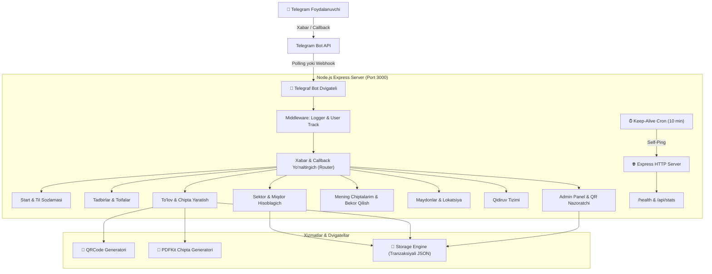

# 🏛️ 01. Tizim Arxitekturasi va Dasturiy Strukturasi

Ushbu hujjatda **ggtickets** loyihasining backend arxitekturasi va jarayonlar oqimi yoritilgan.

---

## 🏗️ Umumiy Arxitektura Diagrammasi



---

## 📂 Fayllar Strukturasi

```
gg_tickets/
├── package.json               # Bog'liqliklar va start skriptlari
├── .env                       # Maxfiy o'zgaruvchilar (Bot token, port, adminlar)
├── .env.example               # Namunaviy konfiguratsiya
├── .gitignore                 # Gitdan chiqarib tashlanadigan fayllar
├── render.yaml                # Render Blueprint deploy fayli
├── Dockerfile                 # Konteynerizatsiya
├── src/
│   ├── index.js               # Asosiy ishga tushirish nuqtasi (Express + Telegraf)
│   ├── config/
│   │   ├── env.js             # Muhit o'zgaruvchilarini tekshirish
│   │   └── constants.js       # Toifalar, to'lov turlari, konstantalar
│   ├── db/
│   │   ├── storage.js         # Tranzaksiyali JSON ma'lumotlar bazasi dvigateli
│   │   └── seed.js            # Dastlabki saroylar va tadbirlarni yuklash
│   ├── i18n/
│   │   ├── uz.js              # O'zbek tili
│   │   ├── ru.js              # Rus tili
│   │   ├── en.js              # Ingliz tili
│   │   └── index.js           # Ko'p tilli tarjima xizmati
│   ├── services/
│   │   ├── qrService.js       # QR kod yaratish (PNG Buffer)
│   │   ├── pdfService.js      # Rasmiy PDF E-Chipta dizayni
│   │   └── keepAliveService.js# Render 24/7 uyquga ketmaslik xizmati
│   ├── keyboards/
│   │   ├── mainKeyboards.js   # Bosh menyu va til tugmalari
│   │   ├── eventKeyboards.js  # Tadbirlar, sektorlar, hisoblagich tugmalari
│   │   └── adminKeyboards.js  # Admin boshqaruv paneli tugmalari
│   ├── handlers/
│   │   ├── startHandler.js    # /start va deep-linklar
│   │   ├── menuHandler.js     # Bosh menyu tugmalarini ushlash
│   │   ├── eventHandler.js    # Tadbirlar katalogi va tafsilotlar
│   │   ├── bookingHandler.js  # Sektor tanlash, +/- soni, promokod
│   │   ├── paymentHandler.js  # To'lovni tasdiqlash va chipta yuborish
│   │   ├── myTicketsHandler.js# Chiptalarni ko'rish, PDF yuklash, bekor qilish
│   │   ├── venuesHandler.js   # Saroylar ro'yxati va xaritalar
│   │   ├── searchHandler.js   # Qidiruv logikasi
│   │   └── adminHandler.js    # Admin statistikasi, QR tekshiruvi, xabarnoma
│   └── utils/
│       ├── formatter.js       # Valyuta (so'm) va sana formatlagich
│       ├── logger.js          # Rangli konsol jurnali
│       └── sessionManager.js  # Ko'p qadamli jarayonlar uchun sessiya boshqaruvi
└── data/                      # Persistent ma'lumotlar (JSON)
    ├── users.json
    ├── events.json
    ├── venues.json
    ├── tickets.json
    ├── orders.json
    └── promos.json
```

---

## ⚡ Gibrid Ishlash Rejimi (Dual Mode)

Dastur avtomatik tarzda ikki xil muhitda ishlashga moslashgan:
1. **Lokal ishlab chiqish (Development):** `WEBHOOK_URL` bo'sh bo'lsa, Telegram **Long Polling** rejimida ishlaydi, qo'shimcha tunnel (ngrok) talab qilinmaydi.
2. **Server (Production on Render):** `WEBHOOK_URL` yoki Renderning `RENDER_EXTERNAL_URL` parametri aniqlansa, bot avtomatik ravishda **Webhook** rejimiga o'tadi va barcha yangilanishlarni Express orqali qabul qiladi.

Keyingi bo'lim: [[02_Malumotlar_Bazasi_va_Modellar]]
