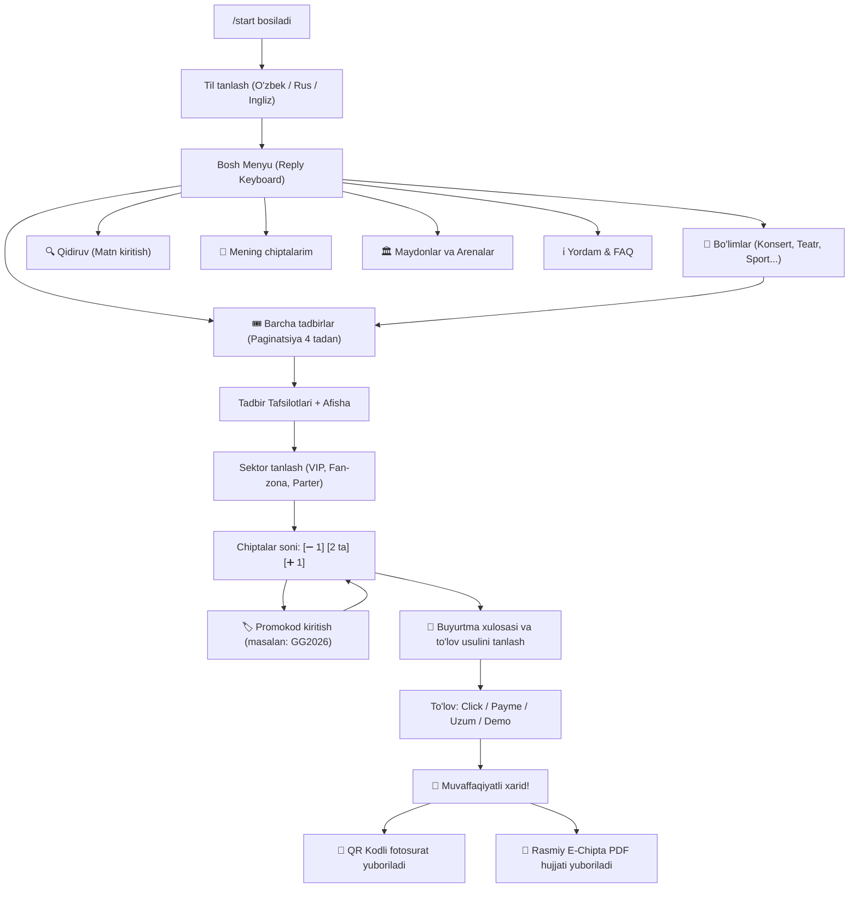

# 📱 03. Telegram Bot UX va Foydalanuvchi Yo'li (User Journey)

**ggtickets** boti foydalanuvchiga maksimal darajada qulay, tushunarli va tezkor interfeys taqdim etadi.

---

## 🗺️ Foydalanuvchi Harakatlari Oqimi (User Flow)

---

## 🎨 Asosiy Ekranlar va Tugmalar Tavsifi

### 1. Bosh Menyu (Persistent Reply Keyboard)
Foydalanuvchining pastki klaviaturasida doimiy joylashgan:
- `🎟 Barcha tadbirlar` — eng yaqin sanadagi barcha tadbirlarni ko'rsatish
- `📂 Bo'limlar` — Konsert, Teatr, Sport, Bolalar, Madaniyat, Shou
- `🎫 Mening chiptalarim` — faol chiptalar va ularning QR kodlari
- `🔍 Qidiruv` — san'atkor, shou yoki maydon nomi bo'yicha qidiruv
- `🏛️ Maydonlar` — Humo Arena, Xalqlar Do'stligi, Navoiy teatri va hk.
- `ℹ️ Yordam & FAQ` — qoidalar, chiptani qaytarish tartibi va qo'llab-quvvatlash
- `🌐 Til (Language)` — tilni bir zumda almashtirish
- `⚙️ Admin Panel` — faqat administrator huquqiga ega bo'lganlarga ko'rinadi

### 2. Tadbir Tafsilotlari (Event Card)
- Tadbir afishasi (Yuqori sifatli fotosurat)
- Tadbir nomi va sanasi
- Bo'lib o'tadigan maydon nomi va manzili
- Narxlar diapazoni (masalan: `150 000 so'm — 800 000 so'm`)
- To'liq tavsif
- Tugmalar: `[ 🎟 Chipta xarid qilish ]`, `[ 📍 Maydon joylashuvi ]`, `[ ⬅️ Ortga ]`

### 3. Sektor va Miqdor Tanlash (Interactive Stepper)
- Har bir sektorda narx va mavjud bo'sh o'rinlar ko'rsatiladi: `VIP Parter — 800 000 so'm (48 ta bo'sh)`
- Agar sektor to'lgan bo'lsa, tugma avtomatik qulflanadi: `❌ Tugagan (Sold out)`
- Miqdor hisoblagich `[ ➖ ] [ 2 ta ] [ ➕ ]` orqali bir necha chiptani bir zumda tanlash mumkin.

### 4. Mening Chiptalarim (My Tickets)
Foydalanuvchi xarid qilgan chiptalarini xohlagan paytda ko'rishi mumkin:
- `[ 📄 PDF Chiptani yuklab olish ]` — chipta PDF faylini qayta yuklab olish
- `[ 📲 QR Kodni ko'rsatish ]` — nazorat punktida tezkor skanerlash uchun
- `[ ❌ Chiptani bekor qilish ]` — agar reja o'zgarsa, chiptani bekor qilish (o'rin avtomatik bo'shaydi)

Keyingi bo'lim: [[04_Elektron_Chipta_QR_va_PDF_Generatsiyasi]]
