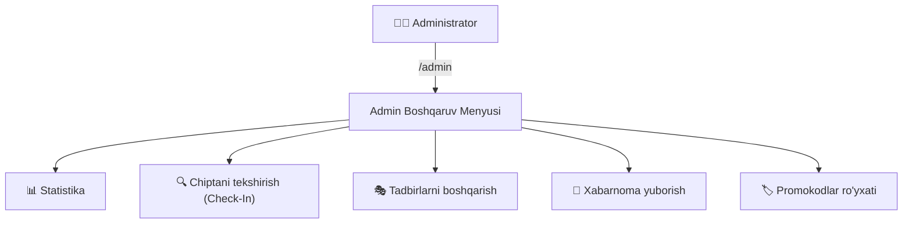

# ⚙️ 05. Admin Paneli va QR Nazoratchi Tizimi

Bot administratorlari uchun ichki boshqaruv paneli (`/admin`) yaratilgan bo'lib, u orqali butun tizimni to'liq nazorat qilish mumkin.

---

## 🔐 1. Huquqlarni Tekshirish (Access Control)

Admin paneliga faqat quyidagi shaxslar kira oladi:
1. `.env` faylidagi `ADMIN_IDS` ro'yxatida Telegram ID si mavjud bo'lganlar.
2. Ma'lumotlar bazasida `role: 'admin'` deb belgilangan foydalanuvchilar.
3. *Qulaylik funksiyasi:* Agar tizim endi ishga tushirilgan bo'lsa va hali birorta admin belgilanmagan bo'lsa, `/admin` komandasini birinchi yozgan foydalanuvchiga avtomatik tarzda asosiy Admin roli beriladi.

---

## 🎛️ 2. Admin Paneli Funksiyalari



### 📊 1. Real Vaqt Statistikasi (`admin_stats`)
Admin bir tugma orqali quyidagi ko'rsatkichlarni ko'radi:
- **Jami foydalanuvchilar soni**
- **Sotilgan chiptalar soni**
- **Umumiy tushum (so'mda)**
- **Faol tadbirlar soni**
- **Jami buyurtmalar soni**

### 🔍 2. QR Kod va Chipta Tekshiruvchi (Gate Scanner)
Bu maydon eshigida turgan nazoratchi (controller) uchun mo'ljallangan:
1. Nazoratchi botga chipta kodini kiritadi (masalan: `GG-7K2X9P`).
2. Tizim chipta holatini tekshiradi:
   - **Agar chipta to'g'ri va faol bo'lsa:**
     ```
     ✅ CHIPTA HAQIQIY VA QABUL QILINDI!
     🎫 Kod: GG-7K2X9P
     🎭 Tadbir: Xamdam Sobirov — Katta Yakkaxon Konsert
     👤 Xaridor: Muhammadali
     📍 Sektor: VIP Parter | O'rin: #42
     💰 Narx: 800 000 so'm
     Holati: FOYDALANILDI (USED) deb belgilandi.
     ```
   - **Agar chiptadan oldinroq kirilgan bo'lsa:**
     ```
     ⚠️ DIQQAT! CHIPTA ALLAQACHON FOYDALANILGAN!
     Bu chipta bilan oldinroq kirilgan! Qayta kirish taqiqlanadi.
     ```
   - **Agar kod xato bo'lsa:**
     ```
     ❌ Chipta topilmadi! Kod noto'g'ri kiritilgan.
     ```

### 🎭 3. Tadbirlarni Boshqarish (`admin_events`)
- Ro'yxatdagi istalgan tadbirni bir marta bosish orqali **Faol (🟢)** yoki **Nofaol (🔴)** holatga o'tkazish mumkin.
- Nofaol tadbirlar oddiy foydalanuvchilarga ko'rinmaydi.

### 📢 4. Ommaviy Xabarnoma (`admin_broadcast`)
- Barcha bot foydalanuvchilariga yangi konsertlar, chegirmalar yoki muhim e'lonlarni yuborish imkoniyati.
- Yuborish yakunlangach, yetkazilgan va xatolik berganlar hisoboti taqdim etiladi.

### 🏷 5. Promokodlar Ro'yxati (`admin_promos`)
- Tizimdagi barcha faol chegirma kodlari, foizlari va minimal buyurtma talablarini ko'rish.

Keyingi bo'lim: [[06_Render_24-7_Deploy_Qollanmasi]]
